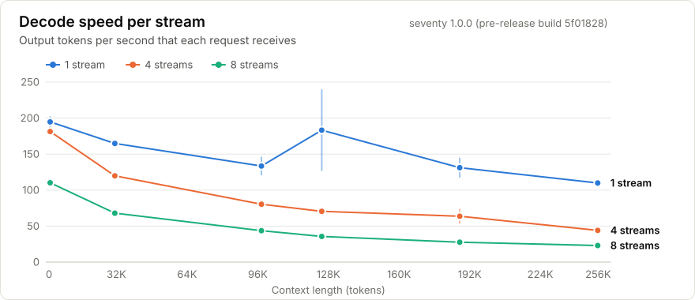

# seventy

seventy is an inference engine for Qwen3.5-family models (Qwen3.5, Qwen3.6, Qwen3.8) on NVIDIA V100 GPUs.
It serves an OpenAI-compatible API and has a control panel in the browser.

**Status:** in development. It is not ready for use yet.

- The design and the plan for version 1 are in [docs/DESIGN.md](docs/DESIGN.md).
- To build and test the code, see [docs/DEVELOPING.md](docs/DEVELOPING.md).

## What you need

- Linux on x86-64.
- 1, 2, 4 or 8 NVIDIA V100 GPUs (16 GB or 32 GB). With more than one GPU, NVLink between the GPUs is recommended.
- NVIDIA driver 525 or later. Driver branch 580 is the last branch for Volta.
- Python 3.12 and [uv](https://docs.astral.sh/uv/) (or pip).
- Disk space for the model: approximately 20 GB for the NVFP4 27B model and 4 GB for its DFlash2 drafter.

## Models

seventy serves checkpoints with the `Qwen3_5ForConditionalGeneration` architecture, with NVFP4 weights
(compressed-tensors) or BF16 or FP16 weights. A DFlash2 drafter makes decoding faster (speculative decoding).

Tested models:

| Model | Use |
|---|---|
| `QUASAR-QAT/Qwen3.8-27B-QUASAR-NVFP4` | target model (text, images, videos) |
| `incoai/Qwen3.8-27B-DFlash2` | drafter for the model above |

To check a checkpoint folder before you start it:

```
seventy check-model /path/to/checkpoint
```

## Speed

These charts show the speed of seventy on 4 Tesla V100-SXM2-32GB GPUs with NVLink (tensor parallel 4). The engine
uses the NVFP4 27B model, the DFlash2 drafter and the INT8 KV cache. Thinking is on. Each request makes 512 tokens.

<picture>
  <source media="(prefers-color-scheme: dark)" srcset="docs/images/speed-total-dark.svg">
  
</picture>

<picture>
  <source media="(prefers-color-scheme: dark)" srcset="docs/images/speed-stream-dark.svg">
  
</picture>

<picture>
  <source media="(prefers-color-scheme: dark)" srcset="docs/images/speed-prefill-dark.svg">
  
</picture>

- A stream is one request. With 4 streams, 4 requests run at the same time.
- In the decode tests, the prompt is in the prefix cache. Thus the decode tests measure only the generation of tokens.
- In the prefill test, the prompt is not in the cache.
- Each test runs two times. The bar at a point shows the range of the runs. The speed of one stream changes most
  from run to run, because the number of draft tokens that the model accepts changes with the text.
- To measure your own GPUs, see "Speed charts" in [docs/DEVELOPING.md](docs/DEVELOPING.md).

<details>
<summary>The numbers in tables</summary>

| Context (tokens) | Streams | Tokens/s per stream | Tokens/s in total |
|---:|---:|---:|---:|
| 2,000 | 1 | 195 | 195 |
| 2,000 | 4 | 181 | 731 |
| 2,000 | 8 | 110 | 859 |
| 32,000 | 1 | 165 | 165 |
| 32,000 | 4 | 120 | 468 |
| 32,000 | 8 | 68 | 541 |
| 100,000 | 1 | 133 | 134 |
| 100,000 | 4 | 80 | 311 |
| 100,000 | 8 | 44 | 345 |
| 128,000 | 1 | 183 | 183 |
| 128,000 | 4 | 70 | 277 |
| 128,000 | 8 | 36 | 280 |
| 192,000 | 1 | 131 | 131 |
| 192,000 | 4 | 64 | 244 |
| 192,000 | 8 | 28 | 215 |
| 256,000 | 1 | 110 | 110 |
| 256,000 | 4 | 44 | 175 |
| 256,000 | 8 | 23 | 180 |

| Prompt (tokens) | Prefill tokens/s | Time to the first token |
|---:|---:|---:|
| 2,000 | 2,821 | 0.7 s |
| 32,000 | 3,268 | 9.8 s |
| 100,000 | 2,485 | 40.2 s |
| 128,000 | 2,256 | 56.7 s |
| 192,000 | 1,871 | 102.6 s |
| 256,000 | 1,601 | 159.9 s |

</details>

## Install

1. Make a virtual environment and install the wheel from the release. Use one of the two options.

   With uv:

   ```
   uv venv --python 3.12 ~/seventy-env
   ```

   ```
   uv pip install -p ~/seventy-env "seventy @ https://github.com/Ruleryak/seventy/releases/download/v1.0.0/seventy-1.0.0-py3-none-linux_x86_64.whl" --extra-index-url https://download.pytorch.org/whl/cu129 --index-strategy unsafe-best-match
   ```

   With pip (a virtual environment from `uv venv` has no pip, thus use `venv` from Python):

   ```
   python3.12 -m venv ~/seventy-env
   ```

   ```
   ~/seventy-env/bin/pip install "seventy @ https://github.com/Ruleryak/seventy/releases/download/v1.0.0/seventy-1.0.0-py3-none-linux_x86_64.whl" --extra-index-url https://download.pytorch.org/whl/cu129
   ```

   You can run the install command again. It does not change an installation that is up to date.

2. Check the GPUs, the driver and the kernel library:

   ```
   ~/seventy-env/bin/seventy info
   ```

The wheel contains the compiled kernels. You do not need the CUDA toolkit.

## Download a model

Download the model and the drafter into the Hugging Face cache:

```
~/seventy-env/bin/hf download QUASAR-QAT/Qwen3.8-27B-QUASAR-NVFP4
```

```
~/seventy-env/bin/hf download incoai/Qwen3.8-27B-DFlash2
```

To use a Hugging Face mirror, set `HF_ENDPOINT` before the command:

```
HF_ENDPOINT=https://your-mirror.example ~/seventy-env/bin/hf download QUASAR-QAT/Qwen3.8-27B-QUASAR-NVFP4
```

The control panel can also download models (Models tab).

## Start with the control panel

The control panel shows the GPUs, calculates the memory plan, starts and stops the engine, and shows the speed,
the cache use and the GPUs while the engine runs. If the engine stops because of an error, the panel writes an
error report and starts the engine again with the last good settings.

To use the panel from this computer only:

```
~/seventy-env/bin/seventy panel
```

Then open http://127.0.0.1:8270/ in a browser.

To use the panel from other computers in your network:

```
~/seventy-env/bin/seventy panel --host 0.0.0.0
```

The panel then prints a URL with a token. Only a browser with this token can use the panel.

The panel keeps its settings, logs and history in `~/.local/state/seventy` (or in the folder that you give with
`--home`).

## Start the engine without the panel

On 4 GPUs, with the drafter:

```
~/seventy-env/bin/seventy engine --model /path/to/model --draft-model /path/to/drafter --gpus 0,1,2,3
```

On 1 GPU, without the drafter:

```
~/seventy-env/bin/seventy engine --model /path/to/model --gpus 0
```

On 2 specified GPUs, open to the network, with an API key:

```
SEVENTY_API_KEY=your-key ~/seventy-env/bin/seventy engine --model /path/to/model --draft-model /path/to/drafter --gpus 2,3 --host 0.0.0.0
```

The API listens on port 8000 (`--port` changes it). Use `seventy engine --help` to see all options.

## Run the panel as a service

1. Make the file `~/.config/systemd/user/seventy.service` with this text:

   ```
   [Unit]
   Description=seventy control panel

   [Service]
   ExecStart=%h/seventy-env/bin/seventy panel --host 0.0.0.0
   KillMode=mixed
   TimeoutStopSec=90
   Restart=on-failure

   [Install]
   WantedBy=default.target
   ```

2. Start the service now and at each boot:

   ```
   systemctl --user enable --now seventy
   ```

3. To start the service at boot also when you are not logged in:

   ```
   sudo loginctl enable-linger $USER
   ```

The panel starts the engine with the last good settings when it starts.

## Use the API

The API is OpenAI-compatible: `/v1/chat/completions` (with streaming, tools, images and videos),
`/v1/completions`, `/v1/models`, `/tokenize`, `/detokenize`, `/health` and `/metrics` (Prometheus).

```
curl http://127.0.0.1:8000/v1/chat/completions -H "Content-Type: application/json" -d '{"model": "Qwen3.8-27B-QUASAR-NVFP4", "messages": [{"role": "user", "content": "Hello"}]}'
```

To turn off thinking for one request, add `"chat_template_kwargs": {"enable_thinking": false}` to the request.

## Credits

seventy uses methods from these projects. Each source file that holds such a method names the project in its header.

| Project | What seventy uses | License |
|---|---|---|
| [1Cat-vLLM](https://github.com/1CatAI/1Cat-vLLM), a fork of [vLLM](https://github.com/vllm-project/vllm) | The push protocol of its tensor-parallel all-reduce for sm70: the data in a slot is also its ready flag (`csrc/allreduce.cu`) | Apache-2.0 |

## License

seventy is licensed under the Apache License 2.0. See [LICENSE](LICENSE). The libraries that seventy installs
(PyTorch, FastAPI and others) have their own licenses. Model weights are not part of seventy.
