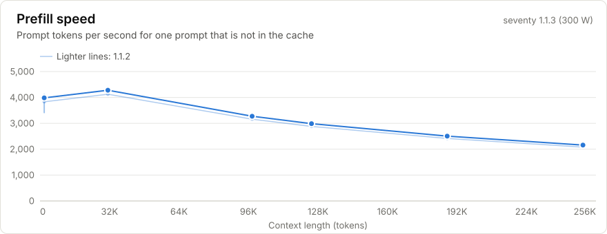
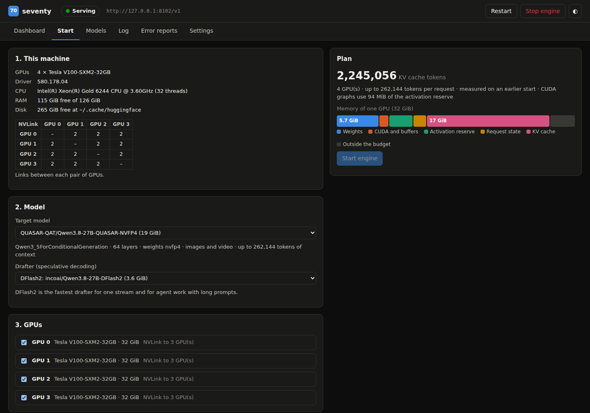
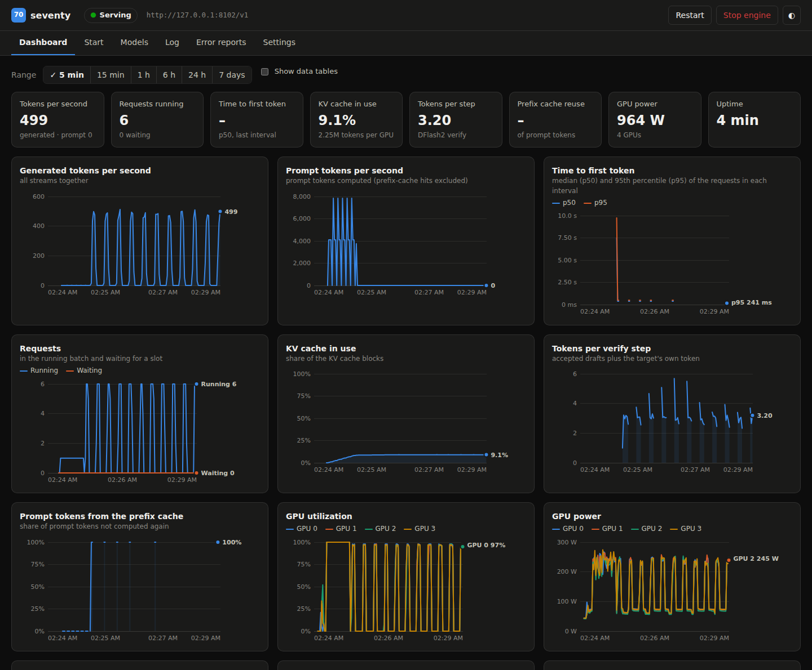

# seventy

seventy is an inference engine for Qwen3.5-family models (Qwen3.5, Qwen3.6, Qwen3.8) on NVIDIA V100 (sm70) GPUs.
It serves an OpenAI-compatible API and has a control panel in the browser.

**Status:** version 1.1.3. The tests ran on 4 Tesla V100-SXM2-32GB GPUs with NVLink. The release notes give the other systems that the release was tested on.

- The design and the plan for version 1 are in [docs/DESIGN.md](docs/DESIGN.md).
- To build and test the code, see [docs/DEVELOPING.md](docs/DEVELOPING.md).

## Models

seventy serves checkpoints with the `Qwen3_5ForConditionalGeneration` architecture, with NVFP4 weights
(compressed-tensors) or BF16 or FP16 weights. A DFlash2 drafter, or the MTP layer of the model, makes decoding faster
(speculative decoding).

Tested models:

| Model | Use |
|---|---|
| `QUASAR-QAT/Qwen3.8-27B-QUASAR-NVFP4` | target model (text, images, videos) |
| `incoai/Qwen3.8-27B-DFlash2` | drafter for the model above |

To check a checkpoint folder before you start it:

```
seventy check-model /path/to/checkpoint
```

## Speed

These charts show the speed of seventy 1.1.2 on 4 Tesla V100-SXM2-32GB GPUs with NVLink (tensor parallel 4), at the
default power limit of 300 W per GPU. The GPUs are GPUs 0 to 3 of a rented machine with 8 GPUs: each pair of the 4 GPUs
has 1 or 2 NVLink links. The engine uses the NVFP4 27B model, the DFlash2 drafter and the INT8 KV cache. Thinking is on.
Each request makes 512 tokens.

The same release on a machine with 4 GPUs (2 NVLink links between each pair) at a power limit of 250 W per GPU made
1% to 2% fewer prompt tokens per second, and decoded about 5% to 15% slower with 4 and 8 streams in most tests. The
numbers are in [bench/results/1.1.2.json](bench/results/1.1.2.json).

<picture>
  <source media="(prefers-color-scheme: dark)" srcset="docs/images/speed-total-dark.svg">
  
</picture>

<picture>
  <source media="(prefers-color-scheme: dark)" srcset="docs/images/speed-stream-dark.svg">
  
</picture>

<picture>
  <source media="(prefers-color-scheme: dark)" srcset="docs/images/speed-prefill-dark.svg">
  
</picture>

- A stream is one request. With 4 streams, 4 requests run at the same time.
- In the decode tests, the prompt is in the prefix cache. Thus the decode tests measure only the generation of tokens.
- In the prefill test, the prompt is not in the cache.
- Each test runs two times. The bar at a point shows the range of the runs. The speed of one stream changes most
  from run to run, because the number of draft tokens that the model accepts changes with the text.
- To measure your own GPUs, see "Speed charts" in [docs/DEVELOPING.md](docs/DEVELOPING.md).

<details>
<summary>The numbers in tables</summary>

| Context (tokens) | Streams | Tokens/s per stream | Tokens/s in total |
|---:|---:|---:|---:|
| 2,000 | 1 | 322 | 322 |
| 2,000 | 4 | 200 | 809 |
| 2,000 | 8 | 125 | 986 |
| 32,000 | 1 | 194 | 194 |
| 32,000 | 4 | 158 | 630 |
| 32,000 | 8 | 85 | 667 |
| 100,000 | 1 | 167 | 168 |
| 100,000 | 4 | 106 | 423 |
| 100,000 | 8 | 59 | 462 |
| 128,000 | 1 | 205 | 205 |
| 128,000 | 4 | 94 | 379 |
| 128,000 | 8 | 54 | 436 |
| 192,000 | 1 | 162 | 162 |
| 192,000 | 4 | 97 | 400 |
| 192,000 | 8 | 53 | 408 |
| 256,000 | 1 | 148 | 148 |
| 256,000 | 4 | 71 | 287 |
| 256,000 | 8 | 39 | 316 |

| Prompt (tokens) | Prefill tokens/s | Time to the first token |
|---:|---:|---:|
| 2,000 | 3,832 | 0.5 s |
| 32,000 | 4,124 | 7.8 s |
| 100,000 | 3,160 | 31.6 s |
| 128,000 | 2,880 | 44.4 s |
| 192,000 | 2,414 | 79.5 s |
| 256,000 | 2,079 | 123.1 s |

</details>

## Quickstart

Start with the control panel to download a model, choose your GPUs, and run the engine.

You need Linux x86_64 (glibc 2.28 or later) and NVIDIA V100 GPUs with a working NVIDIA driver; see [Requirements](docs/ADVANCED.md#requirements). The wheel includes the compiled kernels; no CUDA toolkit or compiler is required. Python 3.12 is installed automatically by uv if needed.

### 1. Install uv

Skip this step if you already have a recent version of [uv](https://docs.astral.sh/uv/getting-started/installation/).

```bash
curl -LsSf https://astral.sh/uv/install.sh | sh
export PATH="$HOME/.local/bin:$PATH"
```

### 2. Install seventy

Run as your normal user:

```bash
uv venv --python 3.12 ~/seventy-env &&
uv pip install --python ~/seventy-env --torch-backend=cu129 \
  "seventy @ https://github.com/Ruleryak/seventy/releases/download/v1.1.3/seventy-1.1.3-py3-none-manylinux_2_28_x86_64.whl" &&
~/seventy-env/bin/seventy info
```

Check the reported GPUs, driver, and kernel library before continuing.

### 3. Start the control panel

If your browser is on the GPU machine:

```bash
~/seventy-env/bin/seventy panel
```

Open [http://127.0.0.1:8270/](http://127.0.0.1:8270/).

If your browser is on another computer, use this command instead:

```bash
~/seventy-env/bin/seventy panel --host 0.0.0.0
```

Open the URL printed in the terminal, including its access token.

In the panel:

1. Use **Models** to download `QUASAR-QAT/Qwen3.8-27B-QUASAR-NVFP4`. Before a download, the panel reads the configuration and the file list of the repository. It tells you if the checkpoint is compatible with seventy and on how many of your GPUs its weights fit. **Check** shows this without a download.
2. Select the model and the GPUs you want to use, review the memory plan, and start the engine.

The drafter is optional. To use it, also download `incoai/Qwen3.8-27B-DFlash2` and select it before starting the engine. It requires additional GPU memory.

Or, select **MTP layer of the model** as the drafter. This drafter uses the MTP layer of the model, so you do not download a drafter. With many short requests at the same time, it is faster than DFlash2. For agent work, DFlash2 is faster. Refer to [Draft with the MTP layer of the model](docs/ADVANCED.md#draft-with-the-mtp-layer-of-the-model).

The **Start** page shows the GPUs and their NVLink links, the model and the drafter, and the memory plan of one GPU before the engine starts:



The **Dashboard** shows the speed, the requests, the KV cache and the GPUs while the engine runs (here with 6 streams at 32K tokens of context):



Keep the panel running. To run it in the background and start it at boot, see [Run the panel as a service](docs/ADVANCED.md#run-the-panel-as-a-service).

### 4. Send a request

Once the engine is ready, open another terminal on the GPU machine:

```bash
curl --fail-with-body -sS http://127.0.0.1:8000/v1/chat/completions \
  -H 'Content-Type: application/json' \
  -d '{
    "model": "Qwen3.8-27B-QUASAR-NVFP4",
    "messages": [{"role": "user", "content": "Say hello in one sentence."}],
    "chat_template_kwargs": {"enable_thinking": false}
  }'
```

## Advanced installation, startup and tuning

[docs/ADVANCED.md](docs/ADVANCED.md) gives the requirements, installation with pip, startup without the panel,
16 GB GPUs, the engine options, model downloads, network access, and the panel as a service.

## Use the API

For a client on the GPU machine, the API base URL is `http://127.0.0.1:8000/v1`. For a remote client, use the GPU machine's address after you [allow API access from another computer](docs/ADVANCED.md#allow-api-access-from-another-computer).

The example model name is `Qwen3.8-27B-QUASAR-NVFP4`. Query `/v1/models` to see the model name advertised by your running engine.

Send a chat request to the local engine started by the quickstart:

```bash
curl --fail-with-body -sS http://127.0.0.1:8000/v1/chat/completions \
  -H 'Content-Type: application/json' \
  -d '{
    "model": "Qwen3.8-27B-QUASAR-NVFP4",
    "messages": [{"role": "user", "content": "Hello"}]
  }'
```

To disable thinking for one request, include `"chat_template_kwargs": {"enable_thinking": false}` in the JSON body, as shown in the quickstart. For streaming, include `"stream": true` and use curl's `--no-buffer` option.

| Endpoint | Purpose |
| --- | --- |
| `/v1/chat/completions` | OpenAI-compatible chat, including streaming, tools, images, and videos |
| `/v1/completions` | OpenAI-compatible text completions |
| `/v1/models` | Available model information |
| `/tokenize` | Tokenization |
| `/detokenize` | Detokenization |
| `/health` | Engine health |
| `/metrics` | Prometheus metrics |

## Credits

seventy uses methods from these projects. Each source file that holds such a method names the project in its header.

| Project | What seventy uses | License |
|---|---|---|
| [1Cat-vLLM](https://github.com/1CatAI/1Cat-vLLM), a fork of [vLLM](https://github.com/vllm-project/vllm) | The push protocol of its tensor-parallel all-reduce for sm70: the data in a slot is also its ready flag (`csrc/allreduce.cu`); the split-D structure of its sm70 D256 prefill attention (`flash_attention_splitd` in `csrc/flash_attention.cu`) | Apache-2.0 |
| [flash-linear-attention](https://github.com/fla-org/flash-linear-attention) | The split of the chunked gated delta rule into a sequential state recurrence and parallel chunk outputs (`csrc/gdn_chunk.cu`) | MIT |

## License

seventy is licensed under the Apache License 2.0. See [LICENSE](LICENSE). The libraries that seventy installs
(PyTorch, FastAPI and others) have their own licenses. Model weights are not part of seventy.
